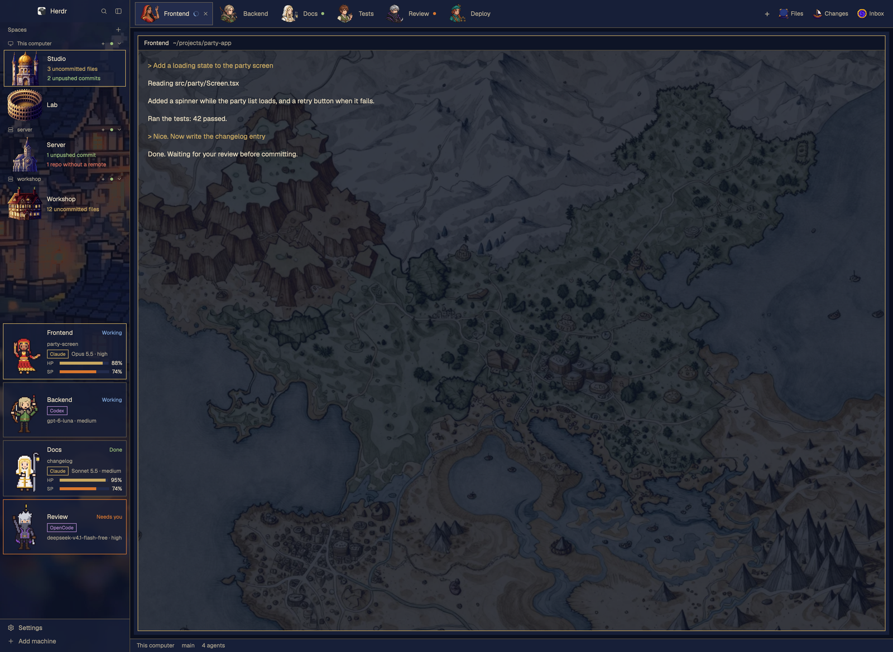
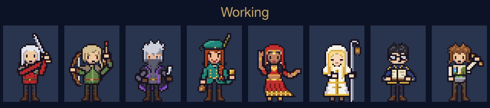

# Traveler

[English](README.md) · [繁體中文](README.zh-TW.md) · **日本語**

Herdr のウィンドウをピクセル RPG に変えるレイアウトです。エージェントはパーティーの仲間に、マシンは建物に、サイドバーは夕暮れの町の一枚絵になります。





## 機能

- **パーティーカード:** エージェントごとに動く全身ドット絵キャラクターが、状態に応じて作業・休憩・手を振って呼びかけます。HP(残りコンテキスト)、SP(5 時間枠の残量)、Claude Code のセッション名も表示します。
- **ひと目で区別:** 各カードにプログラムのタグ(Claude は金、Codex と OpenCode は紫)と、使用中のモデルと effort を表示します。例: `Opus 5.5 · high`。
- **建物:** マシンの Space ごとに宮殿、屋敷、教会、闘技場のいずれかを割り当てます。
- **Git の状況:** 未コミットのファイル、未プッシュのコミット、リモートのないリポジトリを、Space 内の全ターミナルのフォルダーについて集計します。
- **顔グラフィック付きタブ:** 各タブにエージェントの顔を表示します。
- **受信箱パネル:** Files、Changes と並び、フォルダーに入れたファイルを一覧にしてクリックで開きます(開くのは macOS のみ)。

## インストール

Herdr の中でエージェントに次のように頼みます。

> Add the layout from https://github.com/franky5440-afk/herdr-traveler. Read RECIPE.md first.

手動の場合は、リポジトリのフォルダーで実行します。

```sh
H=~/.config/herdr-app
cp layouts/traveler.* "$H/layouts/"
cp themes/traveler-dusk.json "$H/themes/"
cp -R mods/* "$H/mods/"
herdr-app do layout.switch '{"name":"traveler"}'
```

名前が重なる場合は、自分のファイルを上書きせず、先に名前を変更してください。

更新するとき: 上の手順は `mods/traveler-agents/jobs.json` と `mods/traveler-spaces/places.json` を上書きします。先にこの 2 つをバックアップし、インストール後に戻してください。または、この 2 つに触れずに mods を更新します:

```sh
H=~/.config/herdr-app
rsync -a --exclude jobs.json --exclude places.json mods/ "$H/mods/"
```

## カスタマイズ

- **顔グラフィック:** `mods/traveler-agents/jobs.json` を編集します。タブとカードで共通です。タブ名に `warrior`、`merchant`、`thief`、`cleric`、`scholar`、`hunter`、`apothecary`、`dancer` を対応させます。一覧にないタブには空いているキャラクターを割り当て、8 人全員が使われるまで重複しません。
- **建物:** `mods/traveler-spaces/places.json` を編集します。例: `{"My Mac": "palace"}`。選択肢は `palace`、`mansion`、`church`、`colosseum` です。
- **新しい画像:** プロンプトは [docs/ART-PROMPTS.md](docs/ART-PROMPTS.md) にあります。
- **全マシンで同じ顔にする:** 顔グラフィックはタブ名とそのマシンの `jobs.json` で決まります。同じ `jobs.json` を各マシンにコピーしてください。
- **サウンド:** このレイアウトにサウンドは含まれていないため、ご自身のものを使ってください。MP3 を `~/.config/herdr-app/sounds/` に置き、下のキーを `~/.config/herdr-app/settings.json` に追加します。ほかの設定はそのまま残してください。`done` はエージェントの完了時、`blocked` は対応が必要なときに鳴ります。Settings > Alerts の Play ボタンで試聴できます。サウンドは個人設定なので、レイアウトを切り替えても残ります。使用する権利のあるファイルを使ってください。

  ```json
  "sounds": { "enabled": true, "done": "sounds/done.mp3", "blocked": "sounds/blocked.mp3" }
  ```

## HP と SP(任意、Claude Code)

スクリプトをコピーし、Claude Code のステータスラインに設定します。

```sh
mkdir -p ~/.config/herdr-app/data/traveler
cp scripts/traveler-statusline.mjs ~/.config/herdr-app/data/traveler/statusline.mjs
```

```json
{ "statusLine": { "type": "command", "command": "node ~/.config/herdr-app/data/traveler/statusline.mjs", "refreshInterval": 60 } }
```

これを `~/.claude/settings.json` に追加します。既存のステータスラインは置き換えられます。スクリプトが保存するのは数値、セッション名(`/rename` で付けた名前)、モデル名、effort だけです。設定しない場合、HP と SP は `—` と表示されます。別のマシンのエージェントは、そのマシンにもスクリプトを入れてください。カードは Herdr の接続を通じて 1 分ごとに読み込みます。

## Codex と OpenCode のモデルと effort(任意、警告を必ずお読みください)

Claude Code のカードは、上のステータスラインスクリプトからモデルと effort を取得します。Codex と OpenCode にはステータスラインがないため、`scripts/traveler-builder-models.mjs` が 1 分ごとに調べます。入れない場合、これらのカードにはタグだけが表示されます。

> [!WARNING]
> **インストールする前にスクリプトを読んでください。** モデルを調べるため、会話の全文が入ったファイル(Codex の `~/.codex/sessions/**/rollout-*.jsonl`)と、プロバイダーの認証情報も保存されている OpenCode のデータベース(`~/.local/share/opencode/opencode.db`)を読みます。残すのはモデル名と effort の 2 つの文字列だけです。Codex では `session_meta` と `turn_context` の行だけを解析し、OpenCode のデータベースは読み取り専用で開いて `session_v2` テーブルだけを参照します。実行するのは `~/.local/bin/hc ls --json` だけで、ネットワーク接続は開かず、書き込むのは `~/.config/herdr-app/data/traveler/sessions/<ターミナル ID>.json` だけです。権限が大きすぎると感じたら、この節は飛ばしてください。

どのターミナルがどのフォルダーでどのエージェントを動かしているかを知る必要があるため、Codex や OpenCode は、先に `~/.cache/builder-state/<ターミナル ID>` を書き出す小さな起動スクリプトから起動してください:

```sh
#!/bin/sh
# my-codex <folder>   (for OpenCode: kind=opencode and exec opencode)
d=$(cd "${1:-.}" && pwd -P); id=$HC_TERMINAL_ID
mkdir -p ~/.cache/builder-state
printf 'kind=codex\npane=%s\ndir=%s\nstarted=%s\n' "$id" "$d" "$(date +%Y-%m-%dT%H:%M:%S%z)" > ~/.cache/builder-state/"$id"
cd "$d" && exec codex
```

次にスクリプトを入れ、launchd で 1 分ごとに実行します(macOS。`node:sqlite` には Node 22.13 以降が必要です):

```sh
cp scripts/traveler-builder-models.mjs ~/.config/herdr-app/data/traveler/builder-models.mjs
NODE=$(command -v node)
cat > ~/Library/LaunchAgents/dev.herdr-traveler.builder-models.plist <<EOF
<?xml version="1.0" encoding="UTF-8"?>
<!DOCTYPE plist PUBLIC "-//Apple//DTD PLIST 1.0//EN" "http://www.apple.com/DTDs/PropertyList-1.0.dtd">
<plist version="1.0"><dict>
  <key>Label</key><string>dev.herdr-traveler.builder-models</string>
  <key>ProgramArguments</key><array>
    <string>$NODE</string><string>--no-warnings</string>
    <string>$HOME/.config/herdr-app/data/traveler/builder-models.mjs</string>
  </array>
  <key>StartInterval</key><integer>60</integer>
  <key>RunAtLoad</key><true/>
</dict></plist>
EOF
launchctl bootstrap gui/$(id -u) ~/Library/LaunchAgents/dev.herdr-traveler.builder-models.plist
```

制限: Codex は、そのターミナルから対話的に始めたセッション(`originator` が `codex-tui`)で、フォルダーが完全に一致するものだけを数えます。同じフォルダーで同じ種類のエージェントを 2 つ動かすと区別できないため、両方ともモデルを表示しません。OpenCode の `default` の effort は effort なしとして扱います。

## アンインストール

```sh
H=~/.config/herdr-app
herdr-app do layout.switch '{"name":"main"}'
rm -rf "$H"/mods/traveler-agents "$H"/mods/traveler-chrome "$H"/mods/traveler-spaces "$H"/mods/traveler-tabs "$H"/mods/inbox
rm -rf "$H"/data/traveler-agents "$H"/data/traveler-chrome "$H"/data/traveler-spaces "$H"/data/traveler-tabs "$H"/data/traveler "$H"/data/inbox
rm -f "$H"/layouts/traveler.json "$H"/layouts/traveler.png "$H"/layouts/.state/traveler.json "$H"/themes/traveler-dusk.json
launchctl bootout gui/$(id -u)/dev.herdr-traveler.builder-models 2>/dev/null
rm -f ~/Library/LaunchAgents/dev.herdr-traveler.builder-models.plist
```

受信箱フォルダー内のファイルも削除されます。残したいものは先に移動してください。Herdr 自身の `seen.json` には MOD 名が残りますが、影響はありません。

## お使いのマシンで行うこと

- `traveler-spaces` はすべてのターミナルのフォルダーで `git` を自動実行し、`hc machine ls` も実行します。接続中のリモートマシンでは、Herdr がそのマシンで実行します。
- `inbox` は `mkdir`、`find`、`stat`、`open` を実行します。
- どの MOD も自らネットワーク接続を開かず、認証情報も読みません。
- 任意の `traveler-builder-models.mjs` は Herdr の外で動き、上で説明したとおり Codex の会話ファイルと OpenCode のデータベースを読み、`hc ls --json` を実行します。
- **信頼できないリポジトリの中でターミナルを開かないでください。** `git status` は、そのリポジトリ自身の `.git/config` にあるフィルターを実行することがあります(`.git` を含むダウンロードしたアーカイブなど)。クローン内に隠された bare リポジトリはブロックされます。

## ライセンスと画像

コードは Apache 2.0 です。[LICENSE](LICENSE) と [NOTICE](NOTICE) をご覧ください。`traveler-spaces`、`traveler-tabs`、`traveler-chrome` は Herdr 標準 MOD の改変版です。

画像は Meta AI で生成したもので、Apache ライセンスの対象**外**です。[ART-NOTICE.md](ART-NOTICE.md) をご覧ください。キャラクターはすべてオリジナルです。本プロジェクトは Herdr やゲーム会社とは関係ありません。
