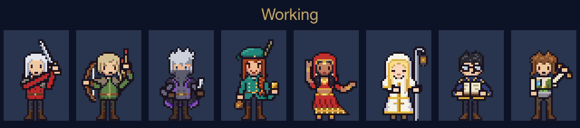

# Traveler

**English** · [繁體中文](README.zh-TW.md) · [日本語](README.ja.md)

Turn your Herdr window into a pixel RPG. Agents become party members, machines become buildings, and the sidebar is one painted town at dusk.




## Features

- **Party cards:** each agent is an animated full-body pixel character that works, rests or waves for you by status, with HP (remaining context), SP (remaining 5-hour quota) and its Claude Code session name.
- **Who is who:** each card has a program tag (Claude in gold, Codex and OpenCode in purple) and the model and effort it runs, for example `Opus 5.5 · high`.
- **Buildings:** each machine's space gets a palace, mansion, church or colosseum.
- **Git at a glance:** uncommitted files, unpushed commits and repos with no remote, added up across every terminal in a space.
- **Portrait tabs:** every tab shows its agent's face.
- **Inbox panel:** sits beside Files and Changes, lists files dropped into a folder and opens them on click; right-click copies a file to the Desktop or moves it to the Trash (macOS only).

## Install

Ask your agent inside Herdr:

> Add the layout from https://github.com/franky5440-afk/herdr-traveler. Read RECIPE.md first.

Or by hand, from the repo folder:

```sh
H=~/.config/herdr-app
cp layouts/traveler.* "$H/layouts/"
cp themes/traveler-dusk.json "$H/themes/"
cp -R mods/* "$H/mods/"
herdr-app do layout.switch '{"name":"traveler"}'
```

Name clashes: never overwrite your own files. Rename first.

Updating: these steps overwrite `mods/traveler-agents/jobs.json` and `mods/traveler-spaces/places.json`. Back up both first, then put them back. Or update the mods while leaving those two files alone:

```sh
H=~/.config/herdr-app
rsync -a --exclude jobs.json --exclude places.json mods/ "$H/mods/"
```

## Customize

- **Portraits:** edit `mods/traveler-agents/jobs.json`; tabs and cards share it. Tab names map to `warrior`, `merchant`, `thief`, `cleric`, `scholar`, `hunter`, `apothecary` or `dancer`. Unlisted tabs get a free character, so nobody repeats until all eight are taken.
- **Buildings:** edit `mods/traveler-spaces/places.json`, for example `{"My Mac": "palace"}`. Options: `palace`, `mansion`, `church`, `colosseum`.
- **New art:** prompts are in [docs/ART-PROMPTS.md](docs/ART-PROMPTS.md).
- **Same faces on every machine:** a portrait comes from the tab name and that machine's `jobs.json`. Copy the same `jobs.json` to each machine.
- **Sounds:** none are included, so use your own. Put MP3 files in `~/.config/herdr-app/sounds/` and add the key below to `~/.config/herdr-app/settings.json`, keeping your other settings. `done` plays when an agent finishes, `blocked` when it needs you. Test them with the Play buttons in Settings > Alerts. Sounds belong to your settings, so switching layouts keeps them; use only files you have the rights to.

  ```json
  "sounds": { "enabled": true, "done": "sounds/done.mp3", "blocked": "sounds/blocked.mp3" }
  ```

## HP and SP (optional, Claude Code)

Copy the script and set it as your Claude Code status line:

```sh
mkdir -p ~/.config/herdr-app/data/traveler
cp scripts/traveler-statusline.mjs ~/.config/herdr-app/data/traveler/statusline.mjs
```

```json
{ "statusLine": { "type": "command", "command": "node ~/.config/herdr-app/data/traveler/statusline.mjs", "refreshInterval": 60 } }
```

Add that to `~/.claude/settings.json`. If you already have a status line, it will be replaced. The script stores only numbers, the session name (set with `/rename`), the model name and the effort. Without it, HP and SP show `—`. For agents on another machine, install the script there too; the card reads it over Herdr's connection once a minute.

## Model and effort for Codex and OpenCode (optional, read the warning)

Claude Code cards get the model and effort from the status line script above. Codex and OpenCode have no status line, so `scripts/traveler-builder-models.mjs` looks them up once a minute. Without it, those cards show only their tag.

> [!WARNING]
> **Read the script before you install it.** To find the model, it reads files that hold your full conversations (Codex `~/.codex/sessions/**/rollout-*.jsonl`) and the OpenCode database (`~/.local/share/opencode/opencode.db`), which also stores your provider credentials. It keeps only two strings, the model name and the effort: for Codex it parses only the `session_meta` and `turn_context` lines, and it opens the OpenCode database read-only and queries only the `session_v2` table. It runs `~/.local/bin/hc ls --json` and nothing else, opens no network connection, and writes only `~/.config/herdr-app/data/traveler/sessions/<terminal id>.json`. If that is more access than you want, skip this section.

It has to know which terminal runs which agent in which folder, so start Codex or OpenCode through a small wrapper that writes `~/.cache/builder-state/<terminal id>` first:

```sh
#!/bin/sh
# my-codex <folder>   (for OpenCode: kind=opencode and exec opencode)
d=$(cd "${1:-.}" && pwd -P); id=$HC_TERMINAL_ID
mkdir -p ~/.cache/builder-state
printf 'kind=codex\npane=%s\ndir=%s\nstarted=%s\n' "$id" "$d" "$(date +%Y-%m-%dT%H:%M:%S%z)" > ~/.cache/builder-state/"$id"
cd "$d" && exec codex
```

Then install the script and run it every minute with launchd (macOS, Node 22.13 or later for `node:sqlite`):

```sh
cp scripts/traveler-builder-models.mjs ~/.config/herdr-app/data/traveler/builder-models.mjs
NODE=$(command -v node)
cat > ~/Library/LaunchAgents/dev.herdr-traveler.builder-models.plist <<EOF
<?xml version="1.0" encoding="UTF-8"?>
<!DOCTYPE plist PUBLIC "-//Apple//DTD PLIST 1.0//EN" "http://www.apple.com/DTDs/PropertyList-1.0.dtd">
<plist version="1.0"><dict>
  <key>Label</key><string>dev.herdr-traveler.builder-models</string>
  <key>ProgramArguments</key><array>
    <string>$NODE</string><string>--no-warnings</string>
    <string>$HOME/.config/herdr-app/data/traveler/builder-models.mjs</string>
  </array>
  <key>StartInterval</key><integer>60</integer>
  <key>RunAtLoad</key><true/>
</dict></plist>
EOF
launchctl bootstrap gui/$(id -u) ~/Library/LaunchAgents/dev.herdr-traveler.builder-models.plist
```

Limits: Codex sessions count only when started from the wrapper's terminal (`originator` is `codex-tui`) in that exact folder. Two agents of the same kind in the same folder can't be told apart, so both show no model. OpenCode's `default` effort shows as no effort.

## Uninstall

```sh
H=~/.config/herdr-app
herdr-app do layout.switch '{"name":"main"}'
rm -rf "$H"/mods/traveler-agents "$H"/mods/traveler-chrome "$H"/mods/traveler-spaces "$H"/mods/traveler-tabs "$H"/mods/inbox
rm -rf "$H"/data/traveler-agents "$H"/data/traveler-chrome "$H"/data/traveler-spaces "$H"/data/traveler-tabs "$H"/data/traveler "$H"/data/inbox
rm -f "$H"/layouts/traveler.json "$H"/layouts/traveler.png "$H"/layouts/.state/traveler.json "$H"/themes/traveler-dusk.json
launchctl bootout gui/$(id -u)/dev.herdr-traveler.builder-models 2>/dev/null
rm -f ~/Library/LaunchAgents/dev.herdr-traveler.builder-models.plist
```

This also deletes everything in your inbox folder, so move anything you want to keep first. Herdr keeps the mod names in its own `seen.json`, which is harmless.

## What it does on your machine

- `traveler-spaces` runs `git` in every folder your terminals are in, by itself, and `hc machine ls`. On connected remote machines, Herdr runs that `git` there.
- `inbox` runs `mkdir`, `find`, `stat`, `open`, `cp` (copy to Desktop, never overwrites) and `trash` (Move to Trash).
- No mod opens a network connection of its own or reads credentials.
- The optional `traveler-builder-models.mjs` runs outside Herdr, reads Codex conversation files and the OpenCode database as described above, and runs `hc ls --json`.
- **Don't open a terminal inside a repo you don't trust.** `git status` can run filters from that repo's own `.git/config`, for example in a downloaded archive that includes `.git`. Bare repos hidden inside a clone are blocked.

## License and art

Code is Apache 2.0, see [LICENSE](LICENSE) and [NOTICE](NOTICE). `traveler-spaces`, `traveler-tabs` and `traveler-chrome` are modified copies of Herdr's built-in mods.

The images were generated with Meta AI and are **not** covered by the Apache license. See [ART-NOTICE.md](ART-NOTICE.md). All characters are original. This project isn't affiliated with Herdr or any game publisher.
