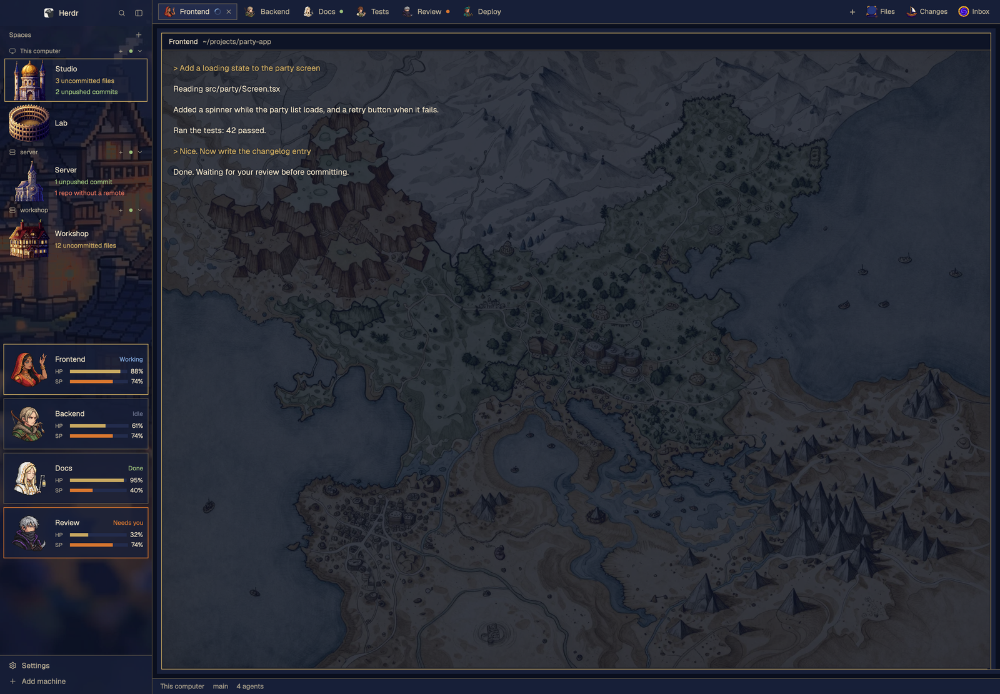

# Traveler

**English** · [繁體中文](README.zh-TW.md) · [日本語](README.ja.md)

Turn your Herdr window into a pixel RPG. Agents become party members, machines become buildings, and the sidebar is one painted town at dusk.



## Features

- **Party cards:** each agent gets a portrait, status, HP (remaining context) and SP (remaining 5-hour quota).
- **Buildings:** each machine's space gets a palace, mansion, church or colosseum.
- **Git at a glance:** uncommitted files, unpushed commits and repos with no remote, added up across every terminal in a space.
- **Portrait tabs:** every tab shows its agent's face.
- **Inbox panel:** sits beside Files and Changes, lists files dropped into a folder and opens them on click (opening is macOS only).

## Install

Ask your agent inside Herdr:

> Add the layout from https://github.com/franky5440-afk/herdr-traveler. Read RECIPE.md first.

Or by hand, from the repo folder:

```sh
H=~/.config/herdr-app
cp layouts/traveler.* "$H/layouts/"
cp themes/traveler-dusk.json "$H/themes/"
cp -R mods/* "$H/mods/"
herdr-app do layout.switch '{"name":"traveler"}'
```

Name clashes: never overwrite your own files. Rename first.

## Customize

- **Portraits:** edit `mods/traveler-agents/jobs.json`; tabs and cards share it. Tab names map to `warrior`, `merchant`, `thief`, `cleric`, `scholar`, `hunter`, `apothecary` or `dancer`. Unlisted tabs get a fixed pick.
- **Buildings:** edit `mods/traveler-spaces/places.json`, for example `{"My Mac": "palace"}`. Options: `palace`, `mansion`, `church`, `colosseum`.
- **New art:** prompts are in [docs/ART-PROMPTS.md](docs/ART-PROMPTS.md).
- **Same faces on every machine:** a portrait comes from the tab name and that machine's `jobs.json`. Copy the same `jobs.json` to each machine.

## HP and SP (optional, Claude Code)

Copy the script and set it as your Claude Code status line:

```sh
mkdir -p ~/.config/herdr-app/data/traveler
cp scripts/traveler-statusline.mjs ~/.config/herdr-app/data/traveler/statusline.mjs
```

```json
{ "statusLine": { "type": "command", "command": "node ~/.config/herdr-app/data/traveler/statusline.mjs", "refreshInterval": 60 } }
```

Add that to `~/.claude/settings.json`. If you already have a status line, it will be replaced. The script stores only numbers. Without it, HP and SP show `—`.

## Uninstall

```sh
H=~/.config/herdr-app
herdr-app do layout.switch '{"name":"main"}'
rm -rf "$H"/mods/traveler-agents "$H"/mods/traveler-chrome "$H"/mods/traveler-spaces "$H"/mods/traveler-tabs "$H"/mods/inbox
rm -rf "$H"/data/traveler-agents "$H"/data/traveler-chrome "$H"/data/traveler-spaces "$H"/data/traveler-tabs "$H"/data/traveler "$H"/data/inbox
rm -f "$H"/layouts/traveler.json "$H"/layouts/traveler.png "$H"/layouts/.state/traveler.json "$H"/themes/traveler-dusk.json
```

This also deletes everything in your inbox folder, so move anything you want to keep first. Herdr keeps the mod names in its own `seen.json`, which is harmless.

## What it does on your machine

- `traveler-spaces` runs `git` in every folder your terminals are in, by itself, and `hc machine ls`. On connected remote machines, Herdr runs that `git` there.
- `inbox` runs `mkdir`, `find`, `stat` and `open`.
- No mod opens a network connection of its own or reads credentials.
- **Don't open a terminal inside a repo you don't trust.** `git status` can run filters from that repo's own `.git/config`, for example in a downloaded archive that includes `.git`. Bare repos hidden inside a clone are blocked.

## License and art

Code is Apache 2.0, see [LICENSE](LICENSE) and [NOTICE](NOTICE). `traveler-spaces`, `traveler-tabs` and `traveler-chrome` are modified copies of Herdr's built-in mods.

The images were generated with Meta AI and are **not** covered by the Apache license. See [ART-NOTICE.md](ART-NOTICE.md). All characters are original. This project isn't affiliated with Herdr or any game publisher.
