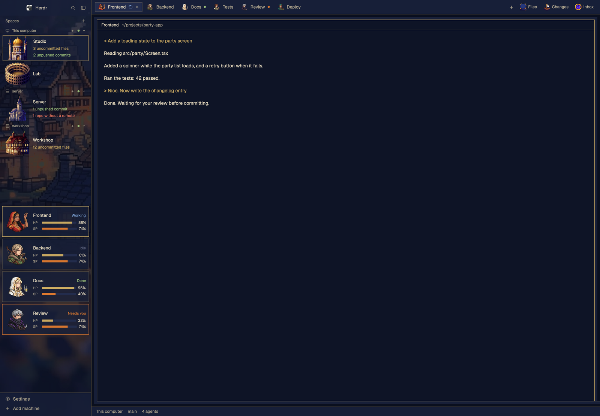

# Traveler 旅人

[English](README.md) · **繁體中文** · [日本語](README.ja.md)

把 Herdr 視窗變成像素 RPG。Agent 是隊伍成員，Machine 是建築，側欄是一整幅黃昏小鎮。



## 功能

- **隊伍卡片：** 每個 agent 有頭像、狀態、HP（剩餘 context）和 SP（5 小時額度剩餘）。
- **建築：** 每台 Machine 的 Space 配皇宮、豪宅、教會或圓形鬥技場。
- **Git 一眼看：** 未 commit 的檔案、未 push 的 commit、沒接遠端的 repo，加總 Space 內每個終端機的資料夾。
- **頭像分頁：** 每個分頁都顯示 agent 的臉。
- **收件匣面板：** 和 Files、Changes 並列，列出丟進資料夾的檔案，點一下開啟（開檔僅支援 macOS）。

## 安裝

在 Herdr 裡跟 agent 說：

> Add the layout from https://github.com/franky5440-afk/herdr-traveler. Read RECIPE.md first.

或在 repo 資料夾手動安裝：

```sh
H=~/.config/herdr-app
cp layouts/traveler.* "$H/layouts/"
cp themes/traveler-dusk.json "$H/themes/"
cp -R mods/* "$H/mods/"
herdr-app do layout.switch '{"name":"traveler"}'
```

名稱撞到時不要覆蓋自己的檔案，先改名。

## 自訂

- **頭像：** 改 `mods/traveler-agents/jobs.json`，分頁和卡片共用這一份。分頁名稱對應 `warrior`、`merchant`、`thief`、`cleric`、`scholar`、`hunter`、`apothecary`、`dancer`；沒列到的會依名稱固定配一位。
- **建築：** 改 `mods/traveler-spaces/places.json`，例如 `{"My Mac": "palace"}`。可選 `palace`、`mansion`、`church`、`colosseum`。
- **換圖：** prompt 在 [docs/ART-PROMPTS.md](docs/ART-PROMPTS.md)。

## HP 和 SP（選用，Claude Code）

複製腳本，再設成 Claude Code 的 status line：

```sh
mkdir -p ~/.config/herdr-app/data/traveler
cp scripts/traveler-statusline.mjs ~/.config/herdr-app/data/traveler/statusline.mjs
```

```json
{ "statusLine": { "type": "command", "command": "node ~/.config/herdr-app/data/traveler/statusline.mjs", "refreshInterval": 60 } }
```

加進 `~/.claude/settings.json`。原本已有 status line 的話會被取代。腳本只存數字；沒裝時 HP、SP 顯示 `—`。

## 它會在你的電腦上做什麼

- `traveler-spaces` 會自動在每個終端機所在的資料夾跑 `git`，並跑 `hc machine ls`。已連線的遠端機器，Herdr 會在那台執行。
- `inbox` 會跑 `mkdir`、`find`、`stat`、`open`。
- 所有 MOD 都不會自己開網路連線，也不讀憑證。
- **不要在不信任的 repo 裡開終端機。** `git status` 可能執行該 repo 自己 `.git/config` 裡的 filter，例如下載的壓縮檔裡帶有 `.git`。藏在 clone 裡的 bare repo 已被擋下。

## 授權與圖片

程式碼採 Apache 2.0，見 [LICENSE](LICENSE) 與 [NOTICE](NOTICE)。`traveler-spaces`、`traveler-tabs`、`traveler-chrome` 是修改過的 Herdr 自帶 MOD。

圖片由 Meta AI 生成，**不在** Apache 授權範圍內，見 [ART-NOTICE.md](ART-NOTICE.md)。角色都是原創設計。本專案與 Herdr 及任何遊戲公司無關。
