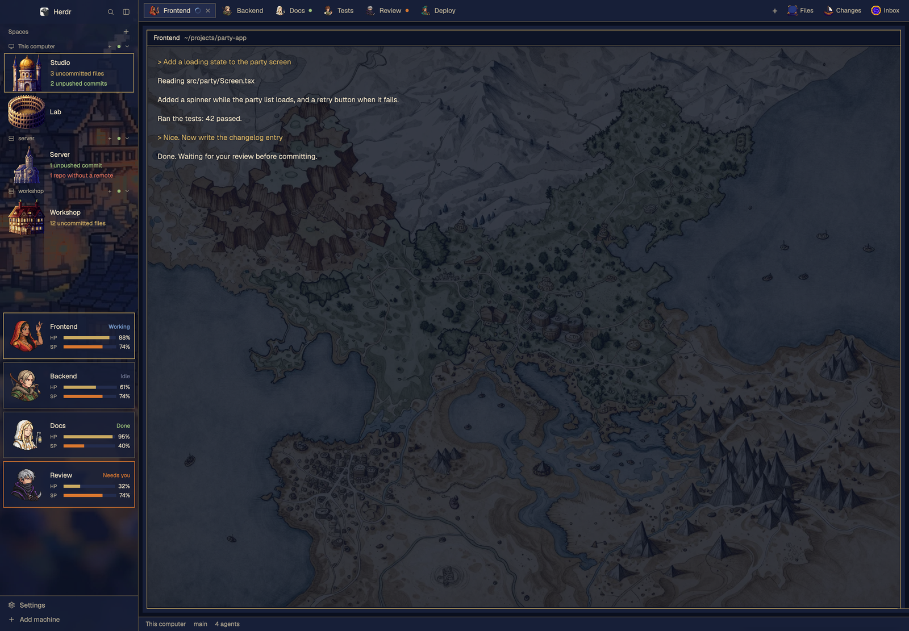

# Traveler

A dusk-toned pixel RPG layout for Herdr. Each agent is a party member with a portrait and HP/SP bars, each machine is a building, and each tab carries its agent's face.

**What you see:**

- **Theme `traveler-dusk`:** deep indigo `#0e1426`, panels `#171f38`, antique gold `#c9a961`, parchment text `#e8dcc0`, ember orange `#d9772f`. Square corners with thin gold frames, no radius.
- **Left sidebar, 268px,** one continuous painted town from top to bottom (`mods/traveler-chrome/sidebar.png`, `cover`). Translucent header 46px, footer 69px.
- **Spaces, top half of the sidebar.** A 76px row per space with a 72px building portrait, the name, and up to three git lines: uncommitted files (`ansi3`), unpushed commits (`ansi2`), repos without a remote (`ansi1`). A clean space shows only its name. The active row has a gold frame on `surface` at `c8` alpha.
- **Agents, bottom half of the sidebar.** One framed card per agent: 72px portrait, tab name, status word, HP bar in `accent`, SP bar in `solid`.
- **Tab bar, 42px.** Square tabs with a 22px portrait, plus right-side Files (book, 20px), Changes (ship, 20px) and Inbox (portal, 20px) buttons, each opening its panel on the right.
- **Main area,** terminal panes on `background` with 1px `#c9a96199` borders and an `accent` border on the focused pane. Pane gap 8px, radius 0.

**How it behaves:**

- **working:** blue status word, spinner on the tab.
- **blocked:** orange status word, orange card frame, orange dot on the tab, overriding the focused frame.
- **done:** green status word, green dot on the tab.
- **idle:** dim status word, nothing on the tab.
- The focused agent's card has a gold frame. Clicking a card focuses that agent.
- Clicking a space selects it, right-click opens its menu, dragging reorders within a machine.
- Tabs and the Files/Changes/Inbox buttons act like the shipped ones. The panel stays remembered per space.
- HP is the session's remaining context, SP is the account's remaining 5-hour quota. With no data both show `—`; numbers older than the freshness limit are marked `old`. They are never estimated.

**Built from:**

- Layout `layouts/traveler.json`, cloned from `main` 0.1.11, theme `traveler-dusk`. Node tree: row `root` → column `sidebar` (block `brand`, column `sidebar-lists` with blocks `spaces` and `agents`, block `sidebar-footer`) and column `work` (block `tabs`, row `work-body` with `main` and hidden `panel`, block `status`).
- `traveler-chrome`: clone of `workspace-chrome`, panel fills at `c8` alpha so the sidebar art shows through. Role by prop `footer`.
- `traveler-spaces`: clone of `spaces`. Replaces the letter tile with `image()`, row height 76, adds `keysOf` (every terminal folder in a space), `sum` (git counts, one per repo top) and `gitLines`. Runs `git status`, `git rev-parse` and `hc machine ls`. Reads `mods/traveler-spaces/places.json`.
- `traveler-tabs`: clone of `tabs`, radius removed, portraits and image buttons added. Its `lib.js` is a copy of the one in `traveler-agents`.
- `traveler-agents`: new mod, uses `agents`, `setAgentOrder`, `readTextFile`, `watchFolder`, `run("agent.focus")`. Reads `mods/traveler-agents/jobs.json` and `data/traveler/sessions/*.json`.
- `inbox`: new mod in the `panel-body` stack, listing `data/inbox/files` and opening an allowed file with the system default app (macOS `open`). Runs `mkdir`, `find`, `stat`, `open`.
- `scripts/traveler-statusline.mjs` (optional): a Claude Code `statusLine` command that writes numbers only to `data/traveler/sessions/<terminal id>.json`.
- Shipped mods used: `pane`, `files`, `changes`, `workspace-status`, `menu`, `new-menu`, `picker`.
- Art: 8 portraits, 4 buildings, 2 icons, 1 sidebar image, in each mod's folder. See `docs/ART-PROMPTS.md`.
- No mod opens a network connection of its own; on connected remote machines Herdr runs the `git` calls there. Nothing reads credentials.

**Watch out:**

- Copy `themes/traveler-dusk.json` to `themes/` too; the layout needs it.
- A mod cannot import from outside its own folder, so `lib.js` exists twice. Change both.
- `image()` remembers a path that was missing. Put images in place before the mod references them, or use a new filename.
- `image()` paths are relative to the Herdr home. Keep `mods/<name>/...` when renaming a mod.
- `herdr-app check` does not catch an undefined name; look at the window.
- Tabs not listed in `jobs.json` get a free job from `assignJobs`, in tab order, so faces repeat only past eight names. Closing or reordering tabs can move an unlisted tab to another face; list it in `jobs.json` to pin it. Spaces not in `places.json` get a fixed pick from their name.
- The clones are of Herdr 0.1.11, and a clean install also passed on 0.1.12. Re-check them after an app update.
- `herdr-app check` really loads a mod, so `inbox` creates `data/inbox/files` and each mod gets a `data/<mod>/` folder before the layout is switched.
- Portraits depend on each machine's `jobs.json`. Two machines match only if they have the same file.
- HP/SP need the optional script and only work for Claude Code. Other agents show `—`.
- On a remote machine, counts update when the machine is reachable.
- Keep `safe.bareRepository=explicit` on the `git status` call: without it, a bare repo committed inside a clone can run a filter as soon as a terminal enters it. It can't stop filters in a repo's own `.git/config`, so tell people not to open terminals in repos they don't trust.

**Done when:**

Herdr must have an open window, and the screen must be unlocked: `herdr-app shot` returns a stale picture on a locked screen.

- `herdr-app check` passes for every mod in `mods/`, and `herdr-app status` shows no errors after `layout.switch {"name":"traveler"}`.
- Each space shows a building, each agent card and tab shows a portrait, Files shows a book, Changes a ship and Inbox a portal, and Inbox opens beside the terminal.
- A repo with an edited file shows `1 uncommitted file` on its space within a minute.
- Without the optional script, HP and SP show `—`, and nothing else changes.
